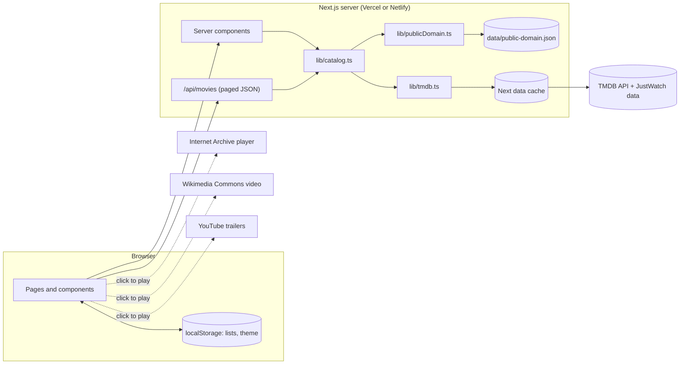

# Architecture

## Overview

## Request flow

1. A page (server component) reads the visitor's country from the `region` cookie, validates the URL filters (`lib/filters.ts`), and calls `listMovies` or `getMovie` in `lib/catalog.ts`.
2. `catalog.ts` decides the source:
   - Public-domain category, or only public-domain sources picked: local JSON.
   - No TMDB token: local JSON, plus a demo-mode notice.
   - Otherwise: TMDB. If TMDB fails, it falls back to local JSON with a notice instead of an error page.
3. TMDB calls go through one function in `lib/tmdb.ts` that adds the token, a timeout, and Next's data cache (1 hour for lists, 6 hours for film details with availability, 24 hours for the provider list). Every entry is tagged `tmdb` so `/api/revalidate` can clear them all.
4. Results from both sources use the same shapes (`lib/types.ts`), so the UI doesn't care where a film came from.
5. Infinite scroll asks `/api/movies?category=...&page=N&region=XX&filters...`. Region is a parameter, not a cookie, so the CDN can cache identical requests.

## Merging the two sources

Wikidata stores TMDB IDs for many public-domain films. At startup `catalog.ts` builds a `tmdbId -> public-domain film` index, which is used to:
- Mark TMDB results as "Free · Public domain" in any list.
- Add the verified free copies to a TMDB film page.
- Upgrade a public-domain film page with TMDB's cast, synopsis, rating and regional offers when a token is set.

## Honesty rules in code

- Availability has three states: `known`, `none` (the source lists nothing for that country) and `unknown` (no source configured). The UI words each one differently and never says "not available anywhere".
- Ratings always carry their source and vote count. TMDB scores under 10 votes and Archive scores under 3 reviews are hidden.
- When a category has to be approximated in demo mode (trending, recent), the page says what it shows instead.
- Missing facts show as "Year unknown", "Runtime unknown", "Not rated", "No synopsis available".

## Security

- The TMDB token lives in server env vars. `lib/config.ts` and `lib/tmdb.ts` import `server-only`, so a build fails if client code imports them.
- All query-string input goes through `parseFilters`, which only accepts known genres, languages, provider id formats, and bounded numbers.
- Strict Content Security Policy (`next.config.ts`): frames only from YouTube's privacy-enhanced domain and archive.org, media only from upload.wikimedia.org, images only from the known hosts.
- `/api/revalidate` needs a bearer secret, compared in constant time. It is off when no secret is set.
- Region cookie is `HttpOnly`, `SameSite=Lax`, `Secure` in production.
- Stored lists are validated on read, so tampered localStorage can't inject odd ids.
- Third-party players load only after a click.

## Data refresh strategy

| Data | How it stays current |
| --- | --- |
| TMDB lists | Cached 1 hour, then refreshed in the background on the next request. |
| Streaming availability | Cached 6 hours per film. `POST /api/revalidate` clears it immediately. |
| Public-domain catalog | `scripts/refresh-public-domain.mjs` rebuilds it weekly in GitHub Actions. The script re-checks that each Archive item and Commons file is still online, so withdrawn items drop out. `validate-catalog.mjs` blocks a broken file, and the commit triggers a redeploy. |
| Catalog age | `GET /api/health` reports `ageDays` and `stale: true` after 14 days. Point a free uptime monitor at it. |

Manual refresh at any time: run the workflow from the GitHub Actions tab ("Run workflow"), or run `npm run refresh:catalog` locally and commit the file.

## Future improvements

- **More free sources with official APIs.** Watchmode (free tier, 1,000 calls a month) for deep links straight to each service. Kanopy and Hoopla don't offer public APIs; they come through JustWatch.
- **Region-aware public domain.** Wikidata has jurisdiction qualifiers for some films (for example "countries with 70 years pma or shorter"). Use them to show public-domain status outside the US.
- **Optional sync.** Export and import of lists as a file, or a passkey-based account for syncing between devices.
- **Faster Commons posters.** Poster URLs currently go through `Special:FilePath`, which adds a redirect per image. Resolving the direct thumbnail URL at refresh time (Commons API `iiurlwidth=342`) would make them load as fast as TMDB posters.
- **Better posters for public-domain films.** Many Archive thumbnails are video frames. Prefer TMDB posters when a TMDB id exists (needs a token at refresh time).
- **Offline support.** A service worker that caches visited pages and the watchlist.
- **End-to-end tests** with Playwright and axe-core in CI.
- **Localization.** UI strings in other languages, and TMDB's `language` parameter for translated titles and synopses.
- **Search suggestions** while typing, debounced through the server.
